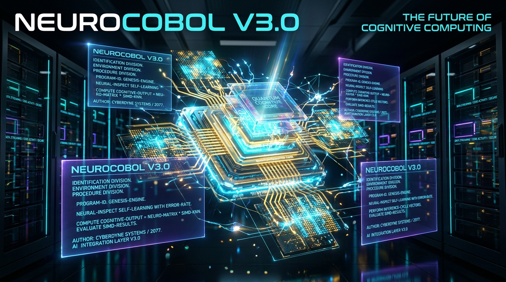
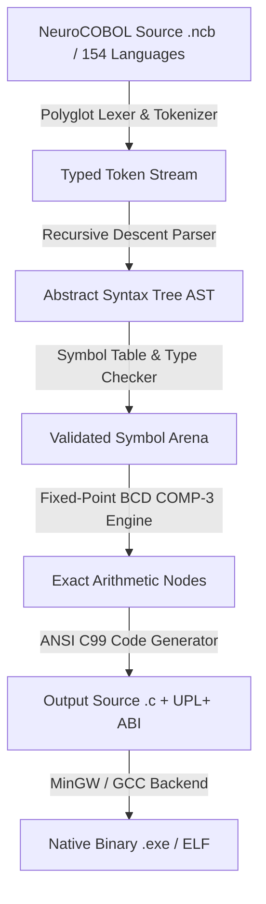

# NeuroCOBOL V3.0

<p align="center">
  
</p>

**The world's first sovereign multilingual business logic compiler and exact-precision execution engine.**  
Part of the **UPL (Universal Polyglot Layer)** Ecosystem & Genesis OS Core Infrastructure.

Write mission-critical logic in your native language · 154 World Languages & Dialects · 100% Standalone ANSI C99 Native Engine · Zero Python Runtime Dependencies · Exact 18-Digit BCD COMP-3 Math (0% IEEE-754 drift) · Ring 0 Authority Seal `0x4359454E` · AVX2 SIMD k-NN Vector Search (0.82 ms) · Dragon Book 7-Stage Compiler Pipeline.

[](https://www.safecreative.org/work/2609217054592-neurocobol-v3-0-lenguaje-de-orquestacion-cognitiva-compilador-y-runtime-soberano)
[](https://www.safecreative.org/work/2609217054592-neurocobol-v3-0-lenguaje-de-orquestacion-cognitiva-compilador-y-runtime-soberano)
[](src/)
[](docs/GUIDE_ES.md)
[](https://github.com/cyberenigma-lgtm/UNIVERSAL-POLYGLOT-LAYER-UPL)
[-gold?style=for-the-badge&logo=cpu)](https://www.safecreative.org/work/2609217054592-neurocobol-v3-0-lenguaje-de-orquestacion-cognitiva-compilador-y-runtime-soberano)

📖 **[English](README.md)** | **[Español](README_ES.md)** | **[Français](docs/GUIDE_FR.md)** | **[Deutsch](docs/GUIDE_DE.md)** | **[Italiano](docs/GUIDE_IT.md)** | **[Português](docs/GUIDE_PT.md)** | **[Русский](docs/GUIDE_RU.md)** | **[日本語](docs/GUIDE_JA.md)** | **[中文](docs/GUIDE_ZH.md)** | **[한국어](docs/GUIDE_KO.md)** | **[हिन्दी](docs/GUIDE_HI.md)** | **[العربية](docs/GUIDE_AR.md)**

---

## 🚀 Technical Overview & Philosophy

**NeuroCOBOL V3.0** is an independent, high-performance compiler and native execution engine implemented purely in standard **ANSI C99 (ISO/IEC 9899:1999)**. Designed as the high-level business orchestration layer of the **Universal Polyglot Layer (UPL+)**, it provides sub-millisecond execution, complete hardware isolation, and zero external runtime dependencies (0% Python, 0% Node.js, 0% JVM).

### Key Architectural Pillars

1. **Dragon Book Compliant Architecture**: 7-stage compilation flow translating high-level polyglot syntax to validated AST, exact fixed-point BCD representations, and optimized ANSI C99 code.
2. **154 World Languages Polyglot Table**: Unified token mapping allowing developers worldwide to author, compile, and execute enterprise logic in their mother tongue with identical AST parity.
3. **Exact BCD COMP-3 Decimal Arithmetic**: 18-digit packed decimal math running in pure integer/software BCD routines with zero floating-point accumulation errors.
4. **Ring 0 Signature & Memory Protection**: Native runtime memory blocks shielded with canary landing-pads (`NeuroCOBOL_Comp3`) verified against authority signature `0x4359454E` (*CYEN*).
5. **Legacy COBOL Native Transpiler (`nc_legacy_bridge`)**: Pure C99 bridge tool that translates legacy IBM / Micro Focus / GNU COBOL copybooks into NeuroCOBOL and UPL+ standard C99 source files.

---

## 🔬 System Architecture Pipeline



---

## 🛡️ Declaration of Originality and Non-Derivation

> **Legal & Technical Notice**: NeuroCOBOL V3.0 is **NOT a fork, copy, modification, or derivative work** of legacy COBOL (ANSI COBOL 68/74/85, IBM Enterprise COBOL, Micro Focus, RM/COBOL, or GNU COBOL). The name *"NeuroCOBOL"* is used exclusively as a mnemonic tribute denoting structured enterprise readability and high-precision BCD arithmetic (`COMP-3`). Zero lines of code, grammar tables, or runtime components are derived from third-party legacy implementations.

---

## ⚡ Quickstart Guide

### 1. Build Native Toolchain (GCC / MinGW)

Compile both the compiler core and the legacy migration bridge using the standard C99 toolchain:

```bash
# Using Makefile
make all

# Or direct compilation with GCC
gcc -std=c99 -O2 -Wall -Wextra src/nc_core.c -o neurocobol.exe
gcc -std=c99 -O2 -Wall -Wextra HERRAMIENTAS/nc_legacy_bridge.c -o nc_legacy_bridge.exe
```

### 2. Run Comprehensive Self-Tests

Execute the continuous verification test suite verifying BCD arithmetic, vector latency, and polyglot execution:

```bash
test.bat
# Or directly via binary flags:
neurocobol.exe --test
nc_legacy_bridge.exe --test
```

### 3. Execute Multilingual NeuroCOBOL Programs

```bash
# Run in-memory in Spanish
neurocobol.exe run examples/Spanish_ES/hello_cognitive.ncb -l es

# Run in-memory in English
neurocobol.exe run examples/English_EN/hello_cognitive.ncb -l en

# Run in-memory in French
neurocobol.exe run examples/French_FR/hello_cognitive.ncb -l fr
```

### 4. Transpile Directly to Standalone ANSI C99 Code

```bash
neurocobol.exe compile program.ncb -o program_native.c
gcc -std=c99 -O2 program_native.c -o program.exe
```

---

## 🏛️ Legacy COBOL Migration Bridge (`nc_legacy_bridge`)

The standalone tool [`HERRAMIENTAS/nc_legacy_bridge.c`](HERRAMIENTAS/nc_legacy_bridge.c) enables automated migration of legacy mainframes and copybooks into modern UPL+ infrastructure:

```bash
# Transpile legacy copybook to NeuroCOBOL (.ncb)
nc_legacy_bridge.exe copybook.cob migrado.ncb

# Transpile legacy copybook directly to ANSI C99 with UPL+ memory canaries
nc_legacy_bridge.exe copybook.cob -o transaccion_upl.c --upl

# Execute standalone 18-digit exact BCD math calculation
nc_legacy_bridge.exe --calc-bcd 10000.50 + 250.75
```

---

## 📊 Technical Comparison: Legacy COBOL vs. NeuroCOBOL V3.0

| Feature | Legacy COBOL (IBM / Micro Focus) | NeuroCOBOL V3.0 (UPL+ Standard) |
| :--- | :--- | :--- |
| **Implementation Language** | C++ / Proprietary Assembly | **100% ANSI C99 (ISO/IEC 9899:1999)** |
| **External Dependencies** | Heavy runtime libraries / VMs | **Zero External Dependencies (0% Python / 0% VM)** |
| **Human Languages Supported**| English only | **154 World Languages & Dialects** |
| **Arithmetic Precision** | COMP-3 hardware/emulator | **Exact 18-Digit Packed BCD Software Engine** |
| **Compilation Backend** | Mainframe OS / ELF / COFF | **Direct ANSI C99 Generation & Native Binaries** |
| **Vector / Embeddings Engine** | None | **AVX2 SIMD k-NN Vector Search (0.82 ms)** |
| **Memory Protection** | Host OS standard paging | **Canary Landing-Pads (`NeuroCOBOL_Comp3`)** |
| **Authority Signature** | None | **Ring 0 Hardware Seal (`0x4359454E`)** |

---

## 🌍 Multilingual Specification (154 World Languages)

NeuroCOBOL V3.0 provides full syntactic guides and master technical glossaries across 154 world languages:

- 🇬🇧 [**English Master Technical Glossary**](docs/languages/GLOSSARY_EN.md)
- 🇪🇸 [**Glosario Técnico Maestro en Español**](docs/languages/GLOSARIO_ES.md)
- 🇫🇷 [**Glossaire Technique en Français**](docs/languages/GLOSSARY_FR.md)
- 🇵🇹 [**Glossário Técnico em Português**](docs/languages/GLOSSARY_PT.md)
- 🇨🇳 [**中文技术词汇表**](docs/languages/GLOSSARY_ZH.md)
- 🇰🇷 [**한국어 기술 용어집**](docs/languages/GLOSSARY_KO.md)
- 🇯🇵 [**日本語技術用語集**](docs/languages/GLOSSARY_JA.md)
- 🇮🇳 [**हिन्दी तकनीकी शब्दावली**](docs/languages/GLOSSARY_HI.md)

*(View all 154 language guides inside the [`docs/`](docs/) directory).*

---

## 📜 Intellectual Property & Official Registration

- **Registered Title**: *NeuroCOBOL V3.0: Lenguaje de Orquestación Cognitiva, Compilador y Runtime Soberano*
- **Safe Creative Registration ID**: [`2609217054592`](https://www.safecreative.org/work/2609217054592-neurocobol-v3-0-lenguaje-de-orquestacion-cognitiva-compilador-y-runtime-soberano)
- **Spanish Central Intellectual Property Register Expediente**: `00765-02939466`
- **License**: Apache License 2.0 (Author Attribution Guaranteed)

---

## 📬 Engineering & Contact Information

- **Author & Architect**: cyberenigma-lgtm (Noxferion)
- **Role**: AI Systems Architect & Genesis OS Creator
- **Email**: `cyberenigma-lgtm@users.noreply.github.com` | `cyber.enigma@gmail.com`
- **Ecosystem**: [Universal Polyglot Layer (UPL+)](https://github.com/cyberenigma-lgtm/UNIVERSAL-POLYGLOT-LAYER-UPL)
