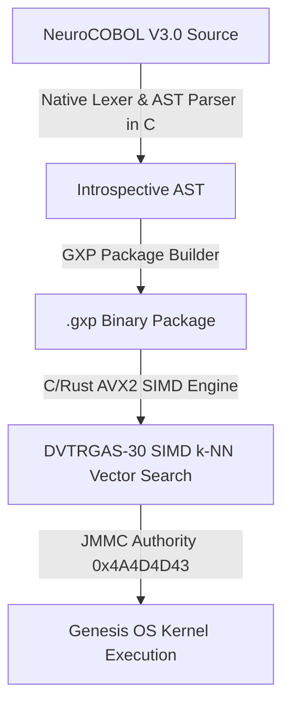

# 🌐 NeuroCOBOL V3.0 — Cognitive Orchestration Language, Compiler & Sovereign Runtime

> **The Sovereign Genesis OS Infrastructure Language & Multi-Agent Hardware Runtime**  
> *Architected by José Manuel Moreno Cano (Noxferion) — AI Systems Architect*

[](https://www.safecreative.org/work/2609217054592-neurocobol-v3-0-lenguaje-de-orquestacion-cognitiva-compilador-y-runtime-soberano)
[](https://www.safecreative.org/work/2609217054592-neurocobol-v3-0-lenguaje-de-orquestacion-cognitiva-compilador-y-runtime-soberano)
[-gold?style=for-the-badge&logo=cpu)](https://www.safecreative.org/work/2609217054592-neurocobol-v3-0-lenguaje-de-orquestacion-cognitiva-compilador-y-runtime-soberano)
[](https://github.com/cyberenigma-lgtm/NeuroCOBOL-V3.0)

---

## 📌 Executive Summary & Legal Declaration of Originality

**NeuroCOBOL V3.0** is an original, high-throughput cognitive orchestration language, native compiler, and Ring 0 runtime developed from scratch by **José Manuel Moreno Cano**.

> **🛡️ Declaration of Non-Derivation**: NeuroCOBOL V3.0 is **NOT a fork, copy, or derivative work** of legacy COBOL (ANSI COBOL 68/74/85, IBM Enterprise COBOL, Micro Focus, or GNU COBOL). The name *"NeuroCOBOL"* is used exclusively as a mnemonic identity tribute for business logic readability and high-precision BCD arithmetic (`COMP-3`), with zero legacy code or grammar dependencies.

---

## 🔬 System Architecture & The Neuro-Triniti



### 🧠 Key Engineering Components

1. **Native Compiler Core in C (`src/nc_lexer.c`, `src/nc_parser.c`)**: High-performance multi-lingual lexical scanner and AST parser with memory leak prevention (`nc_free_ast`).
2. **Ring 0 Kernel Seal (`kernel_native/neural/neurocobol.c`)**: Hardened C validator verifying authority signature `0x4A4D4D43` (*JMMC*) at offset 8 of binary payloads.
3. **Legacy COBOL Transpiler & BCD Bridge (`HERRAMIENTAS/legacy_cobol_bridge.py`)**: Converts legacy copybooks (`PIC X`, `PIC 9(12)V99`, `COMP-3`) into NeuroCOBOL V3.0 and provides 18-digit exact BCD arithmetic.
4. **REST API Microservice (`HERRAMIENTAS/neurocobol_api_server.py`)**: Flask microservice serving compilation, transpilation, and transaction endpoints on port `5050`.

---

## ⚡ Quickstart Guide

### 1. Execute Legacy COBOL Transpiler & COMP-3 BCD Math Bridge
```bash
python HERRAMIENTAS/legacy_cobol_bridge.py
```

### 2. Launch Microservice REST API Server
```bash
python HERRAMIENTAS/neurocobol_api_server.py
```
*Health Check Endpoint*: `http://localhost:5050/api/neurocobol/health`

---

## 📜 Intellectual Property & Copyright Notice

* **Registered Title**: *NeuroCOBOL V3.0: Lenguaje de Orquestación Cognitiva, Compilador y Runtime Soberano*
* **Safe Creative Registration ID**: [`2609217054592`](https://www.safecreative.org/work/2609217054592-neurocobol-v3-0-lenguaje-de-orquestacion-cognitiva-compilador-y-runtime-soberano)
* **Spanish Central IP Register Expediente**: `00765-02939466`
* **License**: Apache License 2.0 (Author Attribution Guaranteed)

---

## 📬 Author & Contact Information

* **Author**: José Manuel Moreno Cano (Noxferion)
* **Role**: AI Systems Architect & Genesis OS Creator
* **Email**: `josem.moreno.cano@gmail.com` | `cyber.enigma@gmail.com`
* **Phone / WhatsApp**: [+34 630 189 616](https://wa.me/34630189616)
