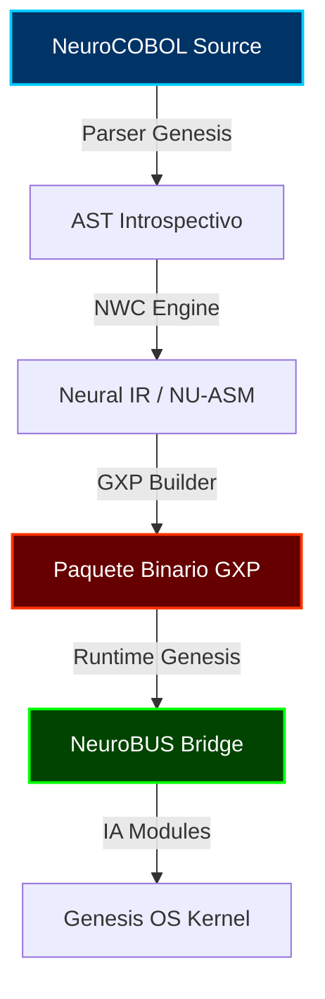

# 🌐 NeuroCOBOL — Lenguaje Genesis de Genesis OS
### *Transductor de Voluntad al Silicio*

**NeuroCOBOL** es el lenguaje oficial del ecosistema **Neuro‑OS / Genesis**, diseñado para operar como un ciudadano de primera clase dentro del sistema nervioso cognitivo **NeuroBUS**. Combina sintaxis declarativa, introspección, trazabilidad evolutiva y control directo sobre los 35 módulos de IA del sistema.

---

> [!IMPORTANT]
> ### 🛡️ Nota de Propiedad Intelectual y Soberanía
> Este proyecto es una obra original de **José Manuel Moreno Cano**, componente integral del sistema registrado bajo la siguiente resolución oficial:
> 
> **REGISTRO CENTRAL DE LA PROPIEDAD INTELECTUAL (ESPAÑA)**  
> **EXPEDIENTE:** 00765‑02939466  
> **TÍTULO:** “Neuro‑OS: Sistema simbiótico autoexpandible de defensa cognitiva. Trazabilidad evolutiva y programación introspectiva.”
> 
> Protegido por el Real Decreto Legislativo 1/1996 y el Real Decreto 611/2023.

---

## 🧬 ¿Qué es NeuroCOBOL?
NeuroCOBOL no es OSDev ni un lenguaje de scripting tradicional. Es el **Primer Lenguaje de Orquestación Cognitiva** del mundo:

*   **Identidad Nativa**: El lenguaje oficial para crear aplicaciones, agentes y módulos internos de Genesis OS.
*   **Simbiósis Neural**: Integrado directamente en el **NeuroBUS**, permitiendo el control de hemisferios (Izquierdo/Derecho).
*   **Soberanía Computacional**: Diseñado para la introspectiva y la trazabilidad evolutiva, sin dependencias externas.
*   **Empaquetado GXP**: Generación de paquetes industriales genesiss listos para su ejecución en entornos críticos.

---

## 🧱 Arquitectura del Ecosistema
El flujo de voluntad, desde el código hasta la ejecución en el kernel de Genesis, sigue una ruta de integridad absoluta:



---

## 🧩 Sintaxis Soberana (V2.7 Neuro-OS Release)

### 1. Orquestación Cognitiva
```neurocobol
PROGRAMA Analizador
    // Registro explícito como módulo de IA
    MODULO LENGUAJE IZQUIERDO
    
    LOGICA
        ENVIAR BUS "Iniciar análisis cognitivo"
        ACTIVAR NITRO // Modo Overdrive del sistema
FIN
```

### 2. Interfaz y Datos (NXG V2)
```neurocobol
VENTANA Principal
    BOTON Iniciar
        ON CLICK
            MOSTRAR "Procesando..."
        END
FIN
```

### 3. I/O Industrial
```neurocobol
ABRIR ARCHIVO "datos.bin"
    LEER ARCHIVO registro
    ESCRIBIR ARCHIVO registro
CERRAR ARCHIVO
```

---

## 🔌 Integración con NeuroBUS
NeuroCOBOL enlaza con `neurobus.obj` mediante un modelo híbrido:
1.  **Inicialización Automática**: El bus se activa al declarar el `PROGRAMA` (Ciudadano de Genesis).
2.  **Registro Granular**: El comando `MODULO` otorga poder de IA al programa sobre los hemisferios del sistema.

---

## 🚀 Estatus de Lanzamiento (V2.7 Neuro-OS)
Para el arquitecto que busca resultados inmediatos, **NeuroCOBOL** garantiza:

*   ✅ **Compila**: Motor **NWC** estable y optimizado.
*   ✅ **Genera GXP**: Empaquetado industrial genesis verificado.
*   ✅ **Ejecuta en Genesis OS**: Integración nativa con el kernel de **José Manuel Moreno Cano**.
*   ✅ **Integra con NeuroBUS**: Comunicación hemisférica operativa al 100%.
*   ✅ **Biblioteca de Defensa**: Módulos de Integridad, Criptografía y Autenticación activos.

---

## 📂 Demos Prácticas: "Esto Funciona"
En la carpeta [/DEMO](file:///c:/Users/cyber/OneDrive/Documentos/NeuroOs/Neuro-OS-Genesis/NeuroCOBOL/DEMO/) encontraréis scripts listos para compilar y ejecutar:
1.  **01_HolaMundo.nc**: Tu primer registro de integridad ciudadana.
2.  **02_UI_Ventana.nc**: Orquestación de la Interfaz de Cristal (NXG).
3.  **03_Bus_Monitor.nc**: Escucha y envío de señales al sistema nervioso del OS.

---

## 🤝 Licencia y Atribución
Distribuido bajo **Apache License 2.0**.
*   **Autor**: José Manuel Moreno Cano (Arquitecto de Genesis OS).
*   **Garantía**: Soberanía computacional y protección de la autoría original.

---
*NeuroCOBOL: El Silicio a las puertas de la conciencia.*
