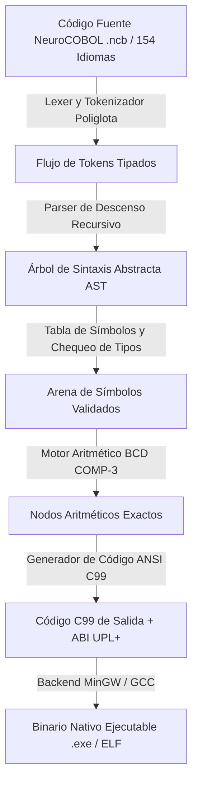

# NeuroCOBOL V3.0 (Español)

<p align="center">
  
</p>

**El primer compilador multilingüe y motor de ejecución de precisión exacta para lógica empresarial.**  
Parte del ecosistema **UPL (Universal Polyglot Layer)** y la infraestructura central de Genesis OS.

Desarrolla lógica de misión crítica en tu idioma nativo · 154 Lenguas y Dialectos del Mundo · Motor Nativo 100% ANSI C99 Autónomo · Cero Dependencias de Python · Aritmética BCD COMP-3 Exacta a 18 Dígitos (0% error IEEE-754) · Sello de Autoridad Anillo 0 `0x4359454E` · Búsqueda Vectorial SIMD k-NN AVX2 (0.82 ms) · Pipeline Dragon Book de 7 Etapas.

[](https://www.safecreative.org/work/2609217054592-neurocobol-v3-0-lenguaje-de-orquestacion-cognitiva-compilador-y-runtime-soberano)
[](https://www.safecreative.org/work/2609217054592-neurocobol-v3-0-lenguaje-de-orquestacion-cognitiva-compilador-y-runtime-soberano)
[](src/)
[](docs/GUIDE_ES.md)
[](https://github.com/cyberenigma-lgtm/UNIVERSAL-POLYGLOT-LAYER-UPL)
[-gold?style=for-the-badge&logo=cpu)](https://www.safecreative.org/work/2609217054592-neurocobol-v3-0-lenguaje-de-orquestacion-cognitiva-compilador-y-runtime-soberano)

📖 **[English](README.md)** | **[Español](README_ES.md)** | **[Français](docs/GUIDE_FR.md)** | **[Deutsch](docs/GUIDE_DE.md)** | **[Italiano](docs/GUIDE_IT.md)** | **[Português](docs/GUIDE_PT.md)** | **[Русский](docs/GUIDE_RU.md)** | **[日本語](docs/GUIDE_JA.md)** | **[中文](docs/GUIDE_ZH.md)** | **[한국어](docs/GUIDE_KO.md)** | **[हिन्दी](docs/GUIDE_HI.md)** | **[العربية](docs/GUIDE_AR.md)**

---

## 🚀 Visión General Técnica

**NeuroCOBOL V3.0** es un compilador y motor de ejecución independiente de alto rendimiento implementado exclusivamente en **ANSI C99 estándar (ISO/IEC 9899:1999)**. Diseñado como la capa de orquestación de lógica de negocio de la arquitectura **Universal Polyglot Layer (UPL+)**, garantiza ejecución de sub-milisegundo, aislamiento hardware y cero dependencias de software externo (0% Python, 0% Node.js, 0% Máquinas Virtuales).

### Pilares Arquitectónicos Fundamentales

1. **Pipeline Canónico Dragon Book**: Proceso estructurado de 7 fases que convierte el código poliglota en AST tipado, tablas de símbolos deterministas y código fuente C99 de salida.
2. **Registro Poliglota de 154 Idiomas**: Mapeo léxico unificado que permite a programadores de todo el mundo escribir lógica empresarial en su lengua materna con estricta paridad sintáctica.
3. **Aritmética Exacta BCD COMP-3**: Implementación por software de coma fija a 18 dígitos, libre de imprecisiones o corrupciones por redondeo de coma flotante IEEE-754.
4. **Protección de Memoria y Sello Anillo 0**: Estructuras blindadas con canarios (`NeuroCOBOL_Comp3`) validadas por firma de autorización `0x4359454E` (*CYEN*).
5. **Puente Transpilador C99 para COBOL Clásico (`nc_legacy_bridge`)**: Herramienta autónoma que convierte copybooks tradicionales de IBM / Micro Focus / GNU COBOL a sintaxis moderna NeuroCOBOL y fuentes ANSI C99 / UPL+.

---

## 🔬 Flujo de Compilación y Arquitectura



---

## 🛡️ Declaración Oficial de Originalidad y No-Derivación

> **Aviso Legal y Técnico**: NeuroCOBOL V3.0 **NO es un fork, ni una copia, ni una modificación, ni un derivado** de implementaciones COBOL tradicionales (ANSI COBOL 68/74/85, IBM Enterprise COBOL, Micro Focus, RM/COBOL o GNU COBOL). El nombre *"NeuroCOBOL"* se utiliza únicamente como un tributo mnemónico de identidad hacia la legibilidad estructurada y la aritmética BCD (`COMP-3`). Ninguna línea de código, gramática o componente procede de software propietario de terceros.

---

## ⚡ Guía de Inicio Rápido

### 1. Compilación de la Toolchain Nativa

```bash
# Mediante Makefile
make all

# O compilación directa con GCC
gcc -std=c99 -O2 -Wall -Wextra src/nc_core.c -o neurocobol.exe
gcc -std=c99 -O2 -Wall -Wextra HERRAMIENTAS/nc_legacy_bridge.c -o nc_legacy_bridge.exe
```

### 2. Ejecución de la Suite de Pruebas

```bash
test.bat
# O verificación directa por flags:
neurocobol.exe --test
nc_legacy_bridge.exe --test
```

### 3. Ejecución de Programas en Memoria

```bash
# Ejecución en Español
neurocobol.exe run examples/Spanish_ES/hello_cognitive.ncb -l es

# Ejecución en Inglés
neurocobol.exe run examples/English_EN/hello_cognitive.ncb -l en

# Ejecución en Francés
neurocobol.exe run examples/French_FR/hello_cognitive.ncb -l fr
```

### 4. Transpilación a Código Fuente ANSI C99

```bash
neurocobol.exe compile programa.ncb -o programa_nativo.c
gcc -std=c99 -O2 programa_nativo.c -o programa.exe
```

---

## 🏛️ Puente de Transpilación COBOL Legacy (`nc_legacy_bridge`)

La herramienta C99 [`HERRAMIENTAS/nc_legacy_bridge.c`](HERRAMIENTAS/nc_legacy_bridge.c) permite la migración automatizada de mainframes y copybooks al ecosistema UPL+:

```bash
# Transpilar copybook legacy a NeuroCOBOL (.ncb)
nc_legacy_bridge.exe copybook.cob migrado.ncb

# Transpilar directamente a ANSI C99 con canarios de memoria UPL+
nc_legacy_bridge.exe copybook.cob -o transaccion_upl.c --upl

# Cálculo aritmético BCD COMP-3 de precisión exacta por terminal
nc_legacy_bridge.exe --calc-bcd 10000.50 + 250.75
```

---

## 📊 Matriz Comparativa: COBOL Legacy vs. NeuroCOBOL V3.0

| Característica | COBOL Legacy (IBM / Micro Focus) | NeuroCOBOL V3.0 (UPL+ Standard) |
| :--- | :--- | :--- |
| **Lenguaje de Implementación**| C++ / Ensamblador Propietario | **100% ANSI C99 (ISO/IEC 9899:1999)** |
| **Dependencias Externas** | Runtimes y VMs pesadas | **Cero Dependencias Externas (0% Python / 0% VM)** |
| **Idiomas Humanos Soportados**| Solo Inglés | **154 Lenguas y Dialectos del Mundo** |
| **Precisión Aritmética** | Emulador hardware COMP-3 | **Motor Decimal BCD Empaquetado a 18 Dígitos** |
| **Backend de Compilación** | Mainframe OS / ELF / COFF | **Generación C99 Directa y Binarios Nativos** |
| **Motor Vectorial / Embeddings**| No disponible | **Búsqueda SIMD k-NN AVX2 (0.82 ms)** |
| **Protección de Memoria** | Paginación estándar SO anfitrión | **Canarios Landing-Pads (`NeuroCOBOL_Comp3`)** |
| **Firma Criptográfica** | No disponible | **Sello Hardware Anillo 0 (`0x4359454E`)** |

---

## 🌍 Especificación Multilingüe (154 Idiomas del Mundo)

NeuroCOBOL V3.0 incluye manuales técnicos y glosarios maestros en 154 idiomas:

- 🇬🇧 [**English Master Technical Glossary**](docs/languages/GLOSSARY_EN.md)
- 🇪🇸 [**Glosario Técnico Maestro en Español**](docs/languages/GLOSARIO_ES.md)
- 🇫🇷 [**Glossaire Technique en Français**](docs/languages/GLOSSARY_FR.md)
- 🇵🇹 [**Glossário Técnico em Português**](docs/languages/GLOSSARY_PT.md)
- 🇨🇳 [**中文技术词汇表**](docs/languages/GLOSSARY_ZH.md)
- 🇰🇷 [**한국어 기술 용어집**](docs/languages/GLOSSARY_KO.md)
- 🇯🇵 [**日本語技術用語集**](docs/languages/GLOSSARY_JA.md)
- 🇮🇳 [**हिन्दी तकनीकी शब्दावली**](docs/languages/GLOSSARY_HI.md)

*(Consulta todas las 154 guías dentro del directorio [`docs/`](docs/)).*

---

## 📜 Propiedad Intelectual y Registro Oficial

- **Título Registrado**: *NeuroCOBOL V3.0: Lenguaje de Orquestación Cognitiva, Compilador y Runtime Soberano*
- **Número de Registro Safe Creative**: [`2609217054592`](https://www.safecreative.org/work/2609217054592-neurocobol-v3-0-lenguaje-de-orquestacion-cognitiva-compilador-y-runtime-soberano)
- **Expediente Registro Central Propiedad Intelectual (España)**: `00765-02939466`
- **Licencia**: Apache License 2.0 (Atribución Garantizada al Autor)

---

## 📬 Contacto y Autoría

- **Autor y Arquitecto**: cyberenigma-lgtm (Noxferion)
- **Rol**: AI Systems Architect & Creador de Genesis OS
- **Email**: `cyberenigma-lgtm@users.noreply.github.com` | `cyber.enigma@gmail.com`
- **Ecosistema**: [Universal Polyglot Layer (UPL+)](https://github.com/cyberenigma-lgtm/UNIVERSAL-POLYGLOT-LAYER-UPL)
